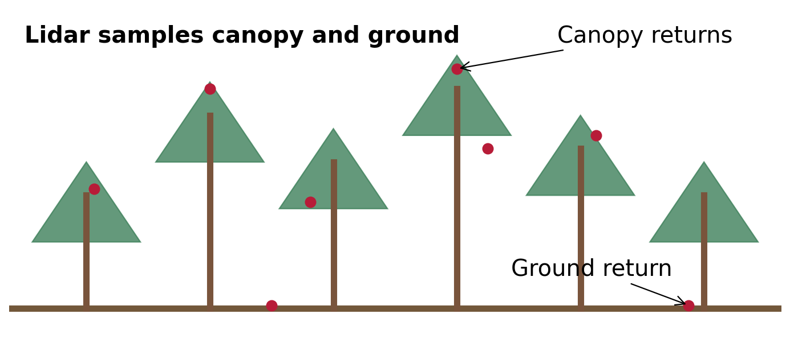
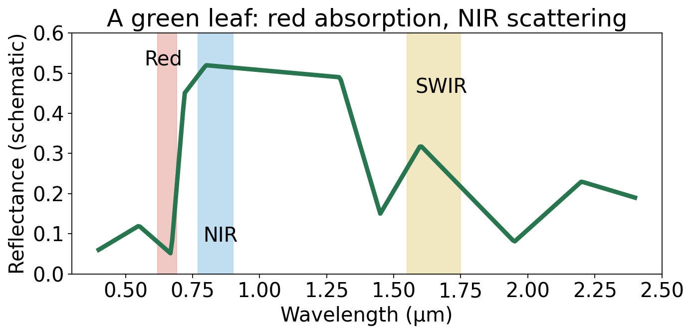
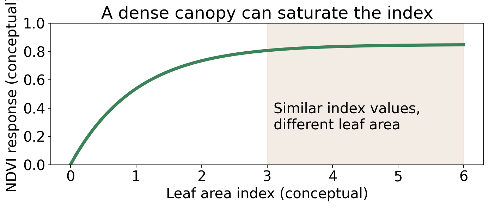
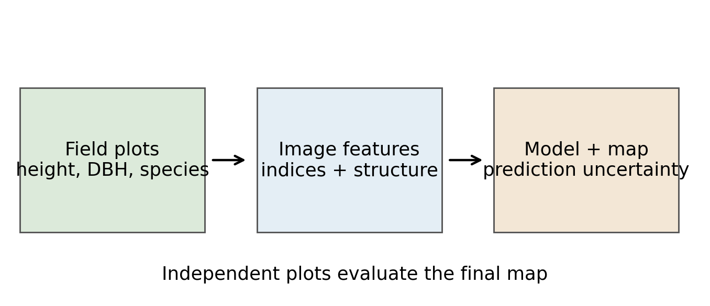
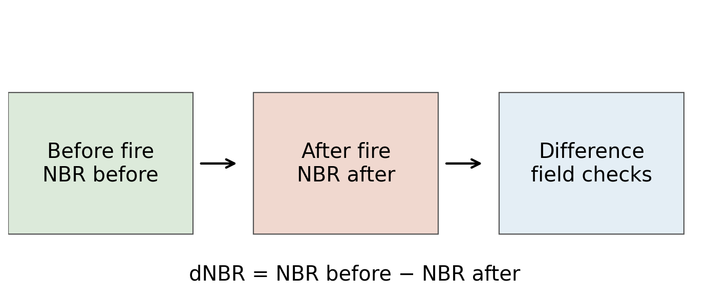

# Remote Sensing of Forests and Vegetation

## From canopy signals to management decisions

John C. Femiani | CSE 620B

---

# A practical question

A forest manager needs to identify stands that may need attention after a hot, dry summer.

- What changes can we observe from above?
- Which measurements need field evidence?
- How could we separate a lasting change from normal seasonal variation?

---

# What you should be able to do

1. Connect forest management questions to remotely sensed measurements.
2. Explain what optical, lidar, and radar data can reveal about a forest.
3. Interpret vegetation and burn indices without treating them as direct measurements of health.
4. Design a field-validated forest monitoring workflow.

---

<!-- _class: divider -->
# 1. What are we trying to measure?

---

# Forestry involves multiple objectives

- Timber and other forest products
- Wildlife habitat and biodiversity
- Carbon storage, water, recreation, and fire risk
- **Silviculture:** establishment, growth, and management of forest stands

A useful map depends on the management objective.

---

# A stand is a management unit

A **forest stand** is a contiguous area with sufficiently similar characteristics to be managed as a unit.

- Examples of characteristics: species, age, size, or structure
- Stands are variable; boundaries are often approximate
- An image pixel, individual tree, stand, and forest are different units of analysis

---

# Match the question to the quantity

| Management question | Target quantity | Possible evidence |
|---|---|---|
| Where did forest cover change? | Cover and change | Multitemporal imagery |
| How tall is the canopy? | Height distribution | Lidar or stereo |
| How much timber is present? | Stand volume | Field plots + remote sensing |
| Where did fire affect vegetation? | Change in surface condition | Before/after imagery + field checks |

---

# What the sensor actually measures

- Optical sensors record reflected sunlight; thermal sensors measure emitted radiation.
- Lidar records laser returns from canopy and sometimes ground.
- Radar measures microwave backscatter influenced by structure and moisture.
- **Biomass, species, and health are inferred** using models and supporting evidence.

---

<!-- _class: divider -->
# 2. Optical signals and canopy properties

---

<!-- _class: figure -->
# Why vegetation has a distinctive spectrum

Chlorophyll absorbs red light; leaf structure strongly scatters near-infrared light. Schematic, not measured data.

---

# From leaf to image pixel

A satellite observes a **canopy and its background**, not a single isolated leaf.

- Crown density, leaf orientation, shadows, and exposed soil affect reflectance.
- A pixel may mix several species, gaps, and nonvegetation.
- Viewing geometry, atmosphere, and season also change the signal.

---

<!-- _footer: "[USGS: Landsat NDVI](https://www.usgs.gov/landsat-missions/landsat-normalized-difference-vegetation-index)" -->
# Normalized Difference Vegetation Index

**NDVI = (ρNIR − ρRed) / (ρNIR + ρRed)**

- Contrasts near-infrared and red **surface reflectance**.
- Often tracks vegetation greenness and cover.
- It is a spectral index—not a direct diagnosis of plant health.

---

# Calculate and interpret NDVI

Suppose red reflectance is **0.10** and NIR reflectance is **0.50**.

**NDVI = (0.50 − 0.10) / (0.50 + 0.10) ≈ 0.67**

This signal is consistent with green vegetation. It does not tell us the species, cause of stress, or biomass by itself.

---

<!-- _footer: "[USGS: NDVI and phenology](https://www.usgs.gov/special-topics/remote-sensing-phenology/science/ndvi-foundation-remote-sensing-phenology)" -->
<!-- _class: figure -->
# Why more vegetation may not mean much more NDVI

NDVI can saturate in dense vegetation; soil and illumination also affect it. Conceptual curve.

---

# Leaf area index: a canopy property

**LAI** is one-sided green leaf area per unit of ground area, commonly expressed as m²/m².

- Related to light interception and canopy structure.
- Optical data can estimate LAI using calibrated models.
- Definitions and measurement methods matter, especially for needleleaf forests.

---

# From an index to an LAI estimate

1. Measure LAI at representative field plots.
2. Match each plot to appropriate image pixels and acquisition dates.
3. Fit an empirical model from spectral features to LAI.
4. Evaluate on independent plots; report errors and domain of use.

A model fitted in one forest or season may not transfer to another.

---

# Other optical indices

- **Simple ratio:** NIR / red; sensitive to vegetation but unstable when red is very small.
- **NDMI:** (NIR − SWIR) / (NIR + SWIR); sensitive to canopy water and other scene properties.
- **NBR:** (NIR − SWIR2) / (NIR + SWIR2); frequently used to study fire effects.

Band definitions vary by sensor. None is a direct measurement of a single forest attribute.

---

# An index change is a clue

A drop in greenness can reflect:

- Seasonal leaf-off, drought, insects, fire, or harvest
- Clouds, shadows, or other image-processing problems
- A mixture of these effects

Compare similar seasons, inspect the time series, and seek independent evidence before assigning a cause.

---

<!-- _class: divider -->
# 3. Measuring forest structure

---

<!-- _class: figure -->
# Lidar samples the canopy in three dimensions

The vertical pattern of returns can describe canopy height and structure. Schematic; not a real point cloud.

---

# From elevations to canopy height

- A **digital surface model** describes upper surfaces, including canopy.
- A **digital terrain model** estimates the ground surface.
- Canopy height ≈ surface elevation − ground elevation.
- Errors in ground estimation or registration propagate to height.

Lidar returns may reach the ground through canopy gaps; this is not guaranteed.

---

# What can lidar support?

- Canopy height distributions and gaps
- Structure across vertical layers and canopy cover proxies
- Individual crowns in favorable data and forest conditions
- Biomass and timber-volume **estimates**, calibrated with field measurements

Detection and accuracy depend on point density, terrain, and canopy structure.

---

<!-- _footer: "[NASA GEDI mission](https://gedi.umd.edu/)" -->
# Airborne lidar and GEDI

- Airborne surveys can sample forest structure across a mapped area.
- GEDI is a spaceborne lidar instrument that samples discrete footprints along tracks.
- Footprints and maps made from them are different products.
- Match spatial coverage and sampling density to the decision.

---

# Radar adds a different view

- SAR measures microwave backscatter and operates day or night.
- It can observe through clouds, though moisture and geometry affect the signal.
- Wavelength and polarization influence sensitivity to canopy components and ground.
- Radar-derived forest attributes need calibration and validation.

---

# Choose complementary observations

| Source | Strength | Limitation |
|---|---|---|
| Optical | Spectral and seasonal information | Cloud cover; dense-canopy saturation |
| Lidar | Vertical canopy structure | Sampling and acquisition costs |
| SAR | Cloud-penetrating observations | Geometry and moisture complicate interpretation |
| Field plots | Direct reference measurements | Limited spatial coverage |

---

<!-- _class: divider -->
# 4. Inventory and forest change

---

<!-- _class: figure -->
# Build an inventory, then test it

Separate plots used for model development from independent plots used to evaluate it.

---

# What is measured in a field plot?

- Species and number of trees
- Diameter at breast height (DBH) and tree height
- Canopy condition, plot location, and observation date
- Plot measurements can support volume or biomass estimates through allometric models.

Measurement uncertainty and location error affect image matching.

---

# Tree species and crown mapping

- Crown shape, size, spectral response, and seasonal behavior can help distinguish trees.
- High-resolution imagery can support individual crown delineation.
- Similar species, shadows, overlapping crowns, and understory trees are difficult.
- A species map is a prediction; evaluate it against independent reference data.

---

# Competing vegetation and forest layers

Understory plants can compete with young trees for light, water, and nutrients.

- Lidar can help describe vertical structure where returns sample multiple layers.
- Seasonal imagery may help distinguish evergreen and deciduous components.
- Neither approach alone guarantees species identification beneath a dense canopy.

---

<!-- _footer: "[USGS: Landsat and forest monitoring](https://www.usgs.gov/news/featured-story/fifty-years-landsat-observing-global-forests-above-canopy)" -->
# Monitor change over time

- Use comparable dates and surface reflectance; mask clouds and shadows.
- Compare observations with a seasonal or multiyear baseline.
- Look for persistent changes and spatial patterns.
- Confirm plausible causes using field observations or independent records.

---

<!-- _class: divider -->
# 5. Fire: before, during, and after

---

# One hazard, several mapping problems

| When? | Question | Example evidence |
|---|---|---|
| Before | Where are fuels and vulnerable areas? | Vegetation and structure maps |
| During | Where is active fire? | Thermal and shortwave IR observations |
| After | Where did surface conditions change? | Pre/post imagery and field plots |
| Later | How is vegetation recovering? | Seasonal time series |

---

# Active fire is a thermal signal

- Hot targets emit more radiation, including in mid-infrared wavelengths.
- MODIS and VIIRS products identify thermal anomalies using multiple tests.
- A detection represents a hot signal within a sensor footprint—not a precise fire boundary.
- Clouds, overpass timing, and small or cool fires can limit detection.

<!-- _footer: "[NASA FIRMS: active fire data](https://firms.modaps.eosdis.nasa.gov/)" -->

---

<!-- _footer: "[USGS: Normalized Burn Ratio](https://www.usgs.gov/landsat-missions/landsat-normalized-burn-ratio)" -->
# Mapping fire effects with NBR

**NBR = (ρNIR − ρSWIR2) / (ρNIR + ρSWIR2)**

Fire-related changes in vegetation and exposed surface can change this spectral contrast. Compare suitable pre-fire and post-fire observations.

---

<!-- _footer: "[USGS: burn severity glossary](https://burnseverity.cr.usgs.gov/glossary)" -->
<!-- _class: figure -->
# From two images to a change map

A larger dNBR often corresponds to greater spectral change; local calibration and field evidence are needed to interpret severity.

---

# Fire severity is not one thing

- **Fire intensity:** energy released during a fire.
- **Fire effects or severity:** changes to vegetation, soil, or another chosen attribute.
- A remotely sensed index is a proxy for change, not a direct soil measurement.
- Define the target, then compare the map with suitable field observations.

---

# Put it together

A manager sees lower NDVI in one stand than last summer.

1. What non-damage explanations should be checked first?
2. What would a lidar or SAR observation add?
3. What field evidence would help distinguish drought, insects, and harvest?
4. At what spatial unit should the result be reported?

---

# Takeaways

- Management questions determine which forest attributes and spatial units matter.
- Optical, lidar, and SAR observations provide complementary evidence.
- Indices reveal patterns; models and field data support forest attribute estimates.
- Compare observations over time and validate the interpretation.

<!-- _footer: "Sources and further reading: see SOURCES.md in the slide folder." -->
