# Remote Sensing of Urban Infrastructure

## From image evidence to building maps

John C. Femiani | CSE 620B

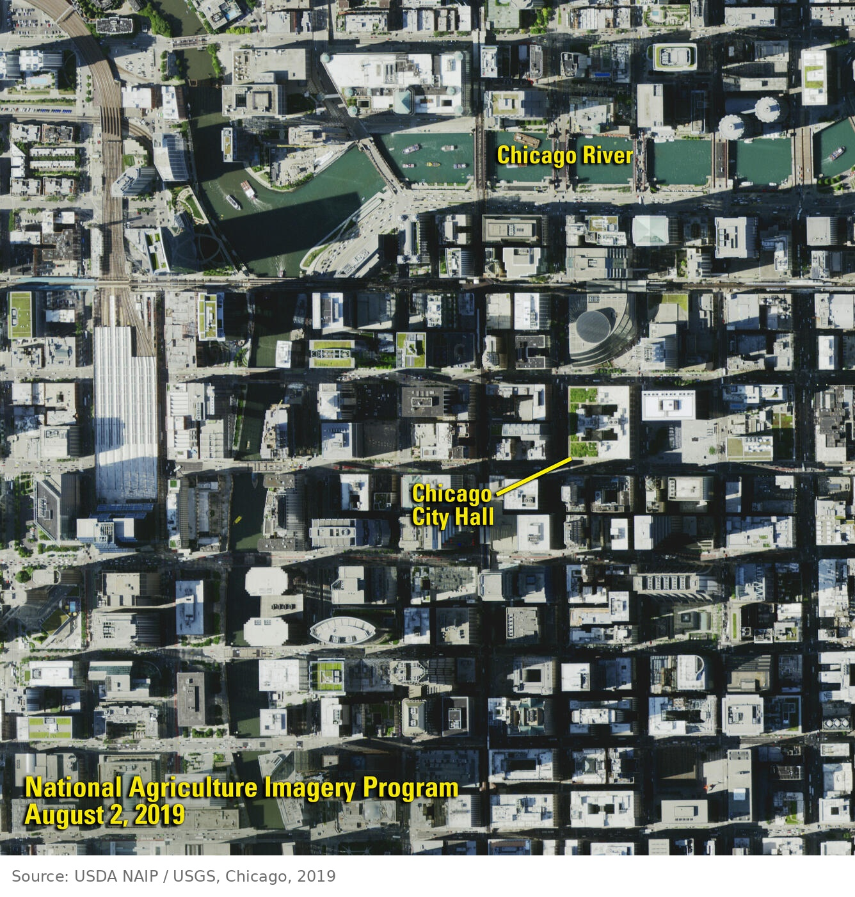

---

<!-- _footer: "[Other flood image: USGS Columbus, Indiana](https://www.usgs.gov/media/images/flooding-columbus-indiana-june-2008)" -->
# A practical question

A city wants to estimate the number and area of buildings exposed to flooding.

- What can an overhead image actually reveal?
- What spatial resolution is needed to distinguish individual roofs?
- How would we know whether the resulting map is reliable?

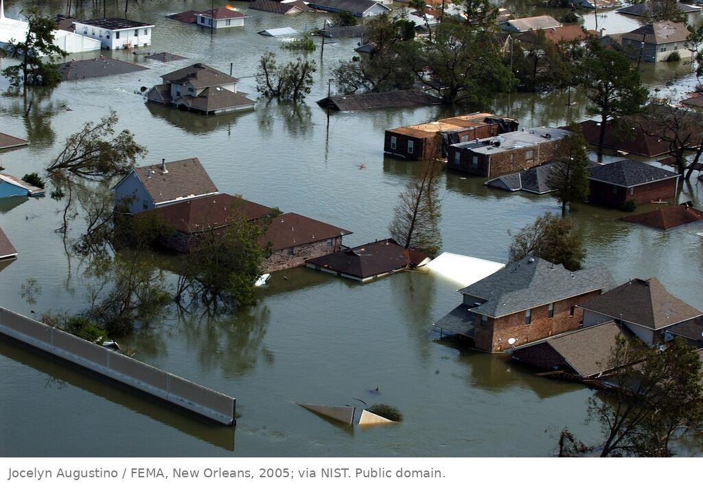

---

<!-- _class: compact -->

# What you should be able to do

1. Distinguish land cover, land use, and individual infrastructure objects.
2. Select imagery and reference data for a building-mapping task.

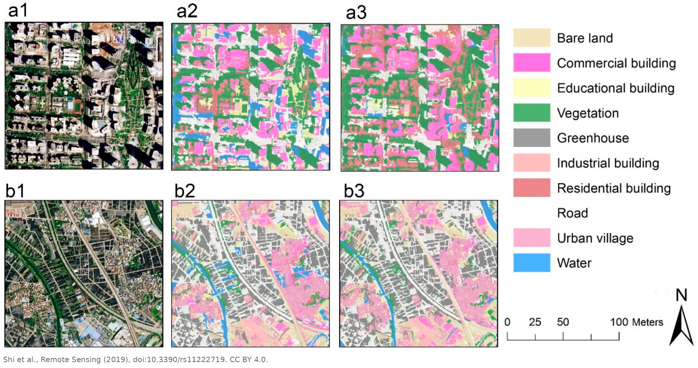

---

<!-- _class: figure -->

# Land use and visible surfaces

How much of a building’s use can the image alone establish?

---

<!-- _class: compact -->

# What you should be able to do

3. Interpret object-level and pixel-level errors.
4. Explain why image predictions need independent validation.

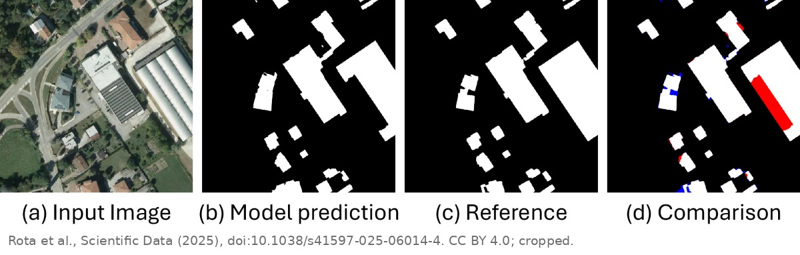

---

<!-- _class: figure -->

# Prediction and independent reference

Image → prediction → reference → disagreement. Red and blue show different error types.

---

<!-- _class: divider -->

# 1. What are we mapping?

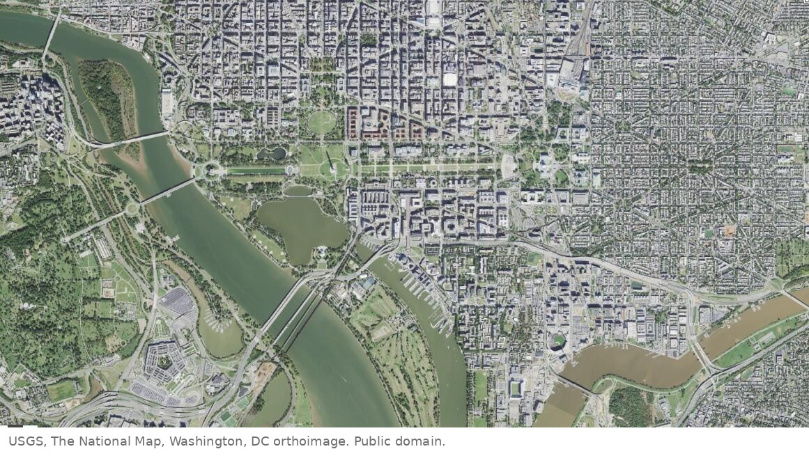

---

<!-- _class: compact -->

# Land cover is not land use

- **Land cover:** physical surface, such as roofs, pavement, or trees.
- **Land use:** activity or purpose, such as residential or commercial.
- A bright roof does not by itself reveal a building's use.
- Context, records, and field checks can support an interpretation.

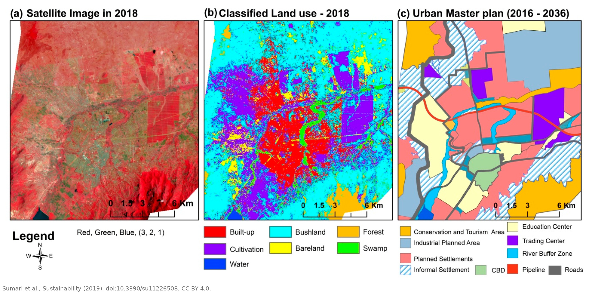

---

<!-- _class: figure -->

# From land cover to planned land use

Morogoro: imagery, classified surface categories, and the city master plan. The plan depicts intended use.

---

<!-- _class: compact -->

# Infrastructure is an object

An individual building has a footprint, shape, location, and relationship to nearby features.

- **Classification:** assign a class to a pixel or region.
- **Detection:** locate candidate objects, often with bounding boxes.
- **Segmentation:** assign an object or class label to pixels.
- A footprint polygon is a geometric representation, not proof of occupancy.

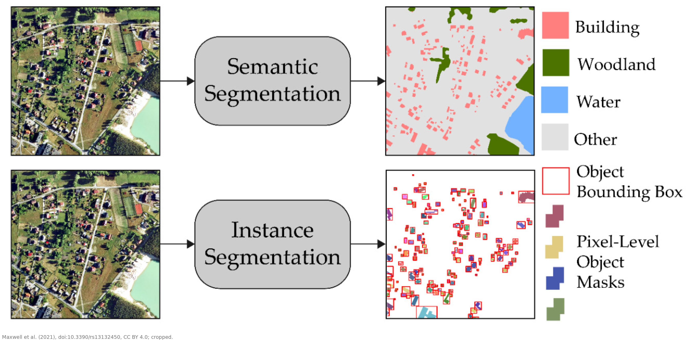

---

<!-- _class: figure -->

# Different tasks: scene and object

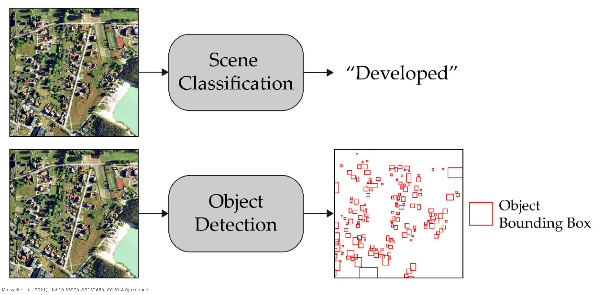

A scene label describes an image; detection locates individual objects.

---

<!-- _class: figure -->

# Different tasks: pixels and instances

Semantic segmentation assigns classes; instance segmentation separates objects.

---

<!-- _footer: "[Original Vancouver exposure map and study](https://doi.org/10.5194/nhess-24-699-2024)" -->
<!-- _class: compact -->

# One scene, several tasks

| Question | Output | Unit |
|---|---|---|
| Where are built surfaces? | Land-cover map | Pixel or region |
| Where are buildings? | Footprints or detections | Object |
| Which buildings intersect flood zones? | Exposure inventory | Building |

The right output depends on the decision, not just the available model.

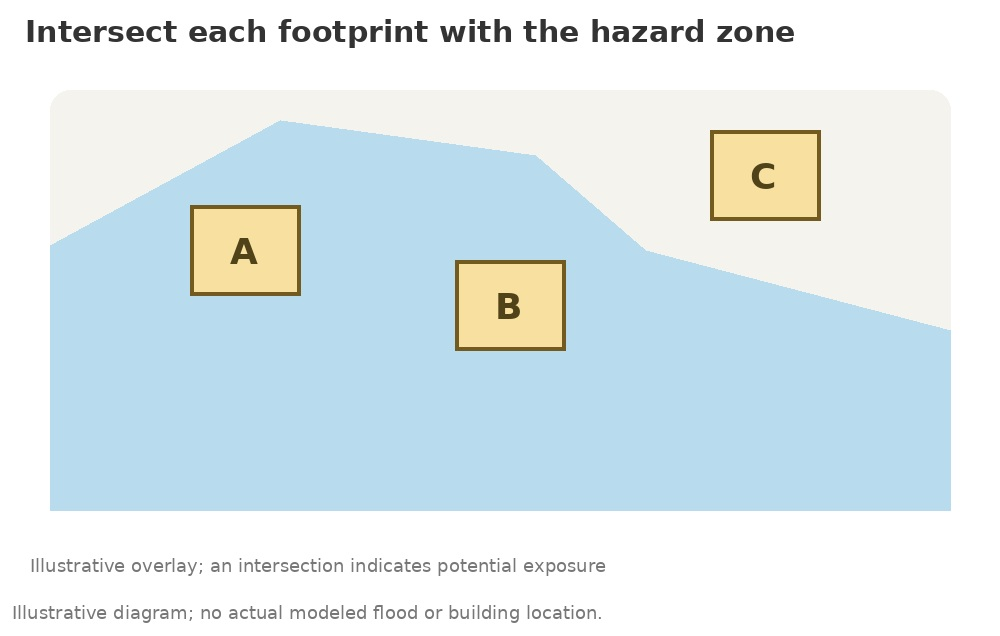

---

<!-- _footer: "[Original Vancouver exposure map and study](https://doi.org/10.5194/nhess-24-699-2024)" -->
<!-- _class: figure -->

# Example: building exposure

Illustrative overlay: exposure is an intersection result, not observed damage.

---

<!-- _class: divider -->

# 2. Choose the evidence

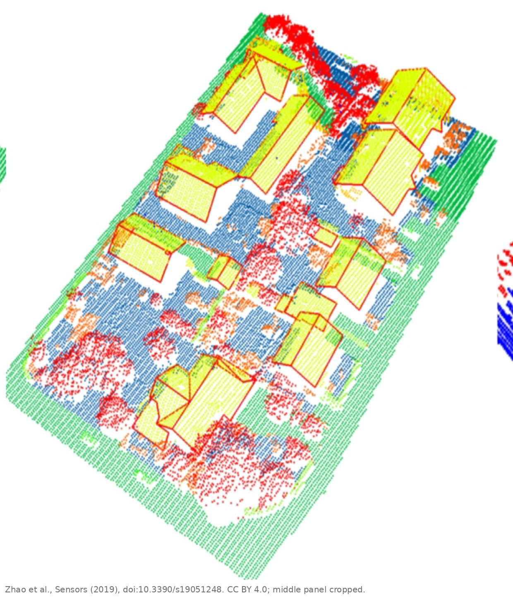

---

<!-- _footer: "[See also: Radiant Earth resolution comparison](https://medium.com/radiant-earth-insights/observing-the-earth-fueling-global-development-solutions-1c69fd5632bc)" -->
<!-- _class: compact -->

# Resolution controls the question

- A 10 m pixel represents roughly a 10 m by 10 m ground area.
- A small roof can share that pixel with trees and pavement.
- Finer imagery can resolve individual roofs, but raises data and annotation costs.
- Resolution is not the same thing as positional accuracy.

---

<!-- _footer: "[See also: Radiant Earth resolution comparison](https://medium.com/radiant-earth-insights/observing-the-earth-fueling-global-development-solutions-1c69fd5632bc)" -->
<!-- _class: figure -->

# One scene, different resolutions

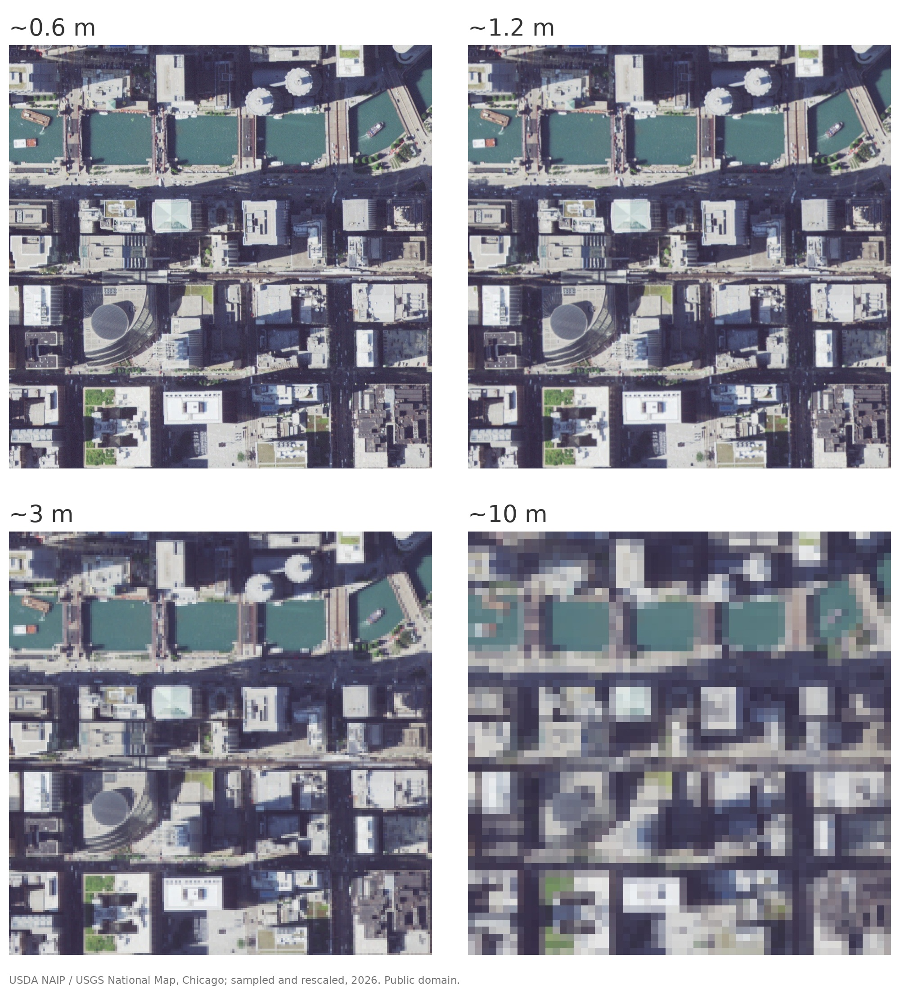

The same NAIP scene is averaged to coarser sampling grids.

---

<!-- _footer: "[See also: Radiant Earth resolution comparison](https://medium.com/radiant-earth-insights/observing-the-earth-fueling-global-development-solutions-1c69fd5632bc)" -->
<!-- _class: figure -->

# Resolution example: 10 m

Averaged from the same ~0.6 m sampling grid; compare with the previous slide.

---

<!-- _footer: "[See also: Radiant Earth resolution comparison](https://medium.com/radiant-earth-insights/observing-the-earth-fueling-global-development-solutions-1c69fd5632bc)" -->
<!-- _class: figure -->

# Resolution example: 3 m

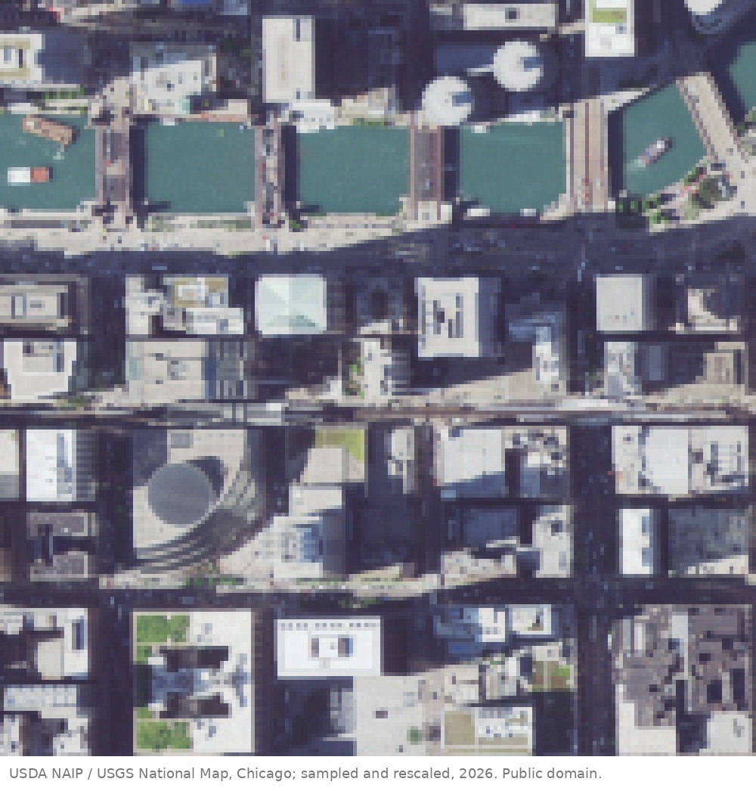

Averaged from the same ~0.6 m sampling grid; compare with the previous slide.

---

<!-- _footer: "[See also: Radiant Earth resolution comparison](https://medium.com/radiant-earth-insights/observing-the-earth-fueling-global-development-solutions-1c69fd5632bc)" -->
<!-- _class: figure -->

# Resolution example: ~0.6 m

Averaged from the same ~0.6 m sampling grid; compare with the previous slide.

---

<!-- _footer: "[See also: Radiant Earth resolution comparison](https://medium.com/radiant-earth-insights/observing-the-earth-fueling-global-development-solutions-1c69fd5632bc)" -->
<!-- _class: figure -->

# Resolution example: ~1.2 m

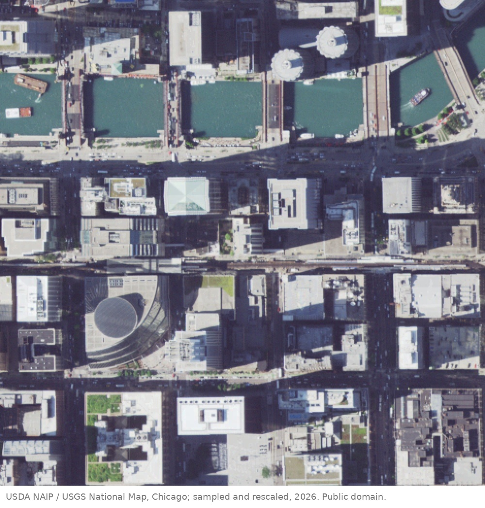

Averaged from the same ~0.6 m sampling grid; compare with the previous slide.

---

<!-- _footer: "[See also: Radiant Earth resolution comparison](https://medium.com/radiant-earth-insights/observing-the-earth-fueling-global-development-solutions-1c69fd5632bc)" -->
<!-- _class: compact -->

# A roof at two scales

Consider a 20 m by 10 m roof, aligned with the pixel grid:

| Ground sampling | Approximate roof extent | What can we see? |
|---|---|---|
| 10 m per pixel | 2 by 1 pixels | A few mixed or roof-dominated pixels |
| 1 m per pixel | 20 by 10 pixels | Roof shape and separation may be visible |

The outcome also depends on alignment, blur, shadows, and sensor geometry.

---

<!-- _footer: "[Other illustrated examples: Yuan (2025)](https://doi.org/10.1038/s41598-025-91206-6)" -->
<!-- _class: compact -->

# Why cities are difficult

- Roofs, roads, and bare soil can have similar colors.
- Shadows and tree canopy can hide parts of a building.
- Tall buildings lean in off-nadir images; roofs and ground footprints may not align.
- Dense blocks make boundaries between adjacent roofs difficult to see.

---

<!-- _footer: "[Other illustrated examples: Yuan (2025)](https://doi.org/10.1038/s41598-025-91206-6)" -->
<!-- _class: figure -->

# Examples of difficult roof extraction

Look for shadows, similar colors, adjacent roofs, and displaced building edges.

---

# Look at the image and labels

Tajikistan image and OSM building labels: [HOT VHR dataset](https://huggingface.co/datasets/hotosm/vhr-building-segmentation). Imagery: Open Imagery Network contributors, CC BY 4.0; labels: OpenStreetMap contributors, ODbL 1.0.

---

<!-- _class: compact -->

# Different sensors answer different questions

- **Aerial or high-resolution optical imagery:** visible roof shapes and context.
- **Multispectral satellite imagery:** broad surface composition and repeated coverage.
- **Lidar:** height and 3D structure, subject to point density and coverage.
- **Ancillary data:** footprints, parcels, and flood maps add context but have their own errors.

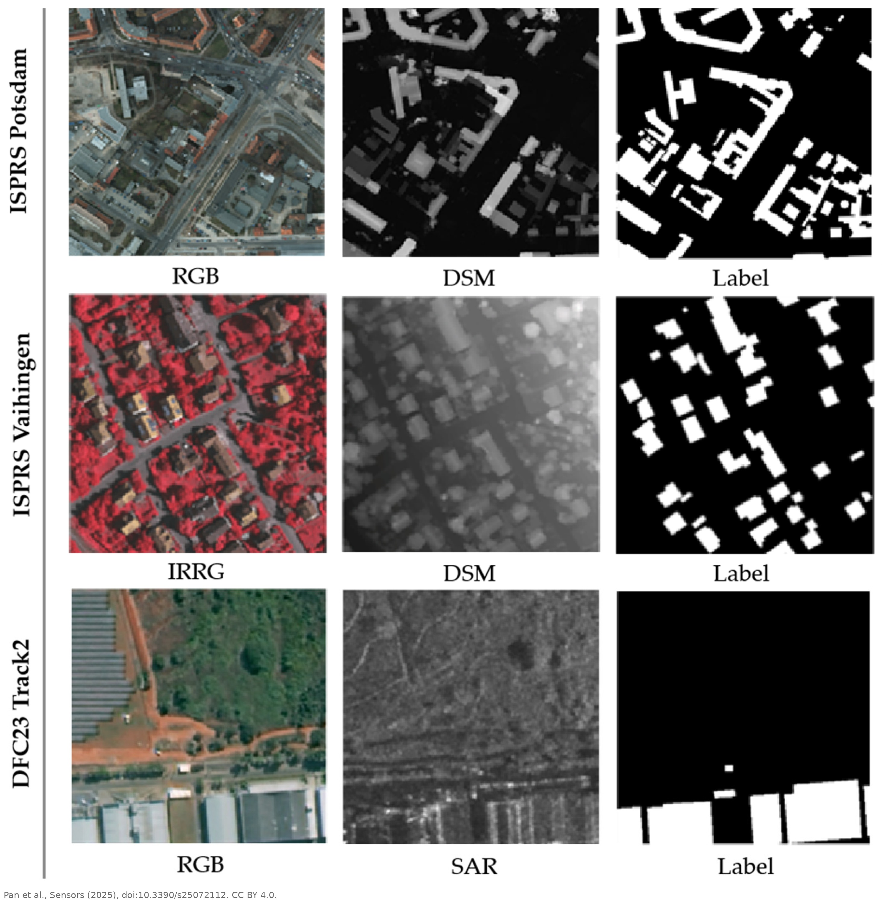

---

<!-- _class: figure -->

# Optical imagery and complementary data

Rows use optical imagery with DSMs or SAR; reference masks appear at right.

---

<!-- _class: compact -->

# Roofs are not always footprints

In an oblique image, the roof appears displaced from its ground location.

- Compare acquisition geometry and dates before overlaying a vector map.
- Check alignment on multiple objects across the image.
- Avoid treating a visible roof edge as a surveyed building outline.

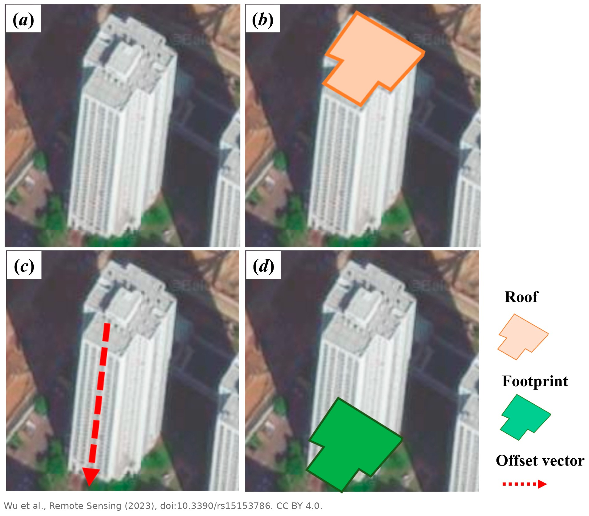

---

<!-- _class: figure -->

# Roof-to-footprint displacement

Image geometry and building height shift the roof relative to the footprint.

---

<!-- _footer: "[Geoxy’s Poland project and examples](https://www.geoxy.pl/en.budynki_3d_lod2_city_gml.html) · [3DBAG credit](https://docs.3dbag.nl/en/copyright/)" -->
<!-- _class: compact -->

# Beyond a 2D footprint

- A 3D building model can represent height, walls, and roof shape.
- A complex building may contain parts with different heights and roof forms.
- Elevated connections can join structures above the ground.
- What counts as one building depends on the mapping purpose and representation.

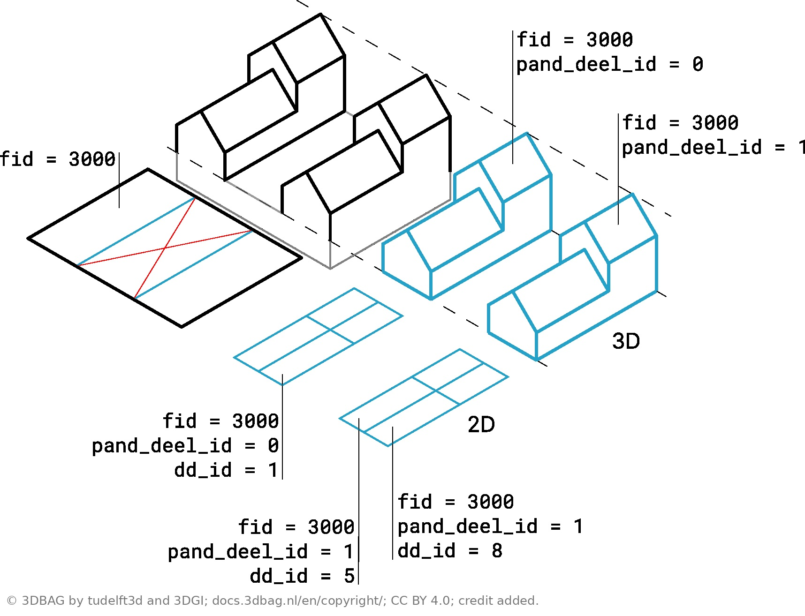

---

<!-- _footer: "[Geoxy’s Poland project and examples](https://www.geoxy.pl/en.budynki_3d_lod2_city_gml.html) · [3DBAG credit](https://docs.3dbag.nl/en/copyright/)" -->
<!-- _class: figure -->

# 3D models and roof shapes

3DBAG (Netherlands) represents a building as 2D and 3D parts; details vary by dataset.

---

<!-- _footer: "[Other example: Asoka Hospital bridge](https://architectures.jidipi.com/j00109988/en/asoka-hospital-south-wing)" -->
<!-- _class: figure -->

# Buildings connected above ground

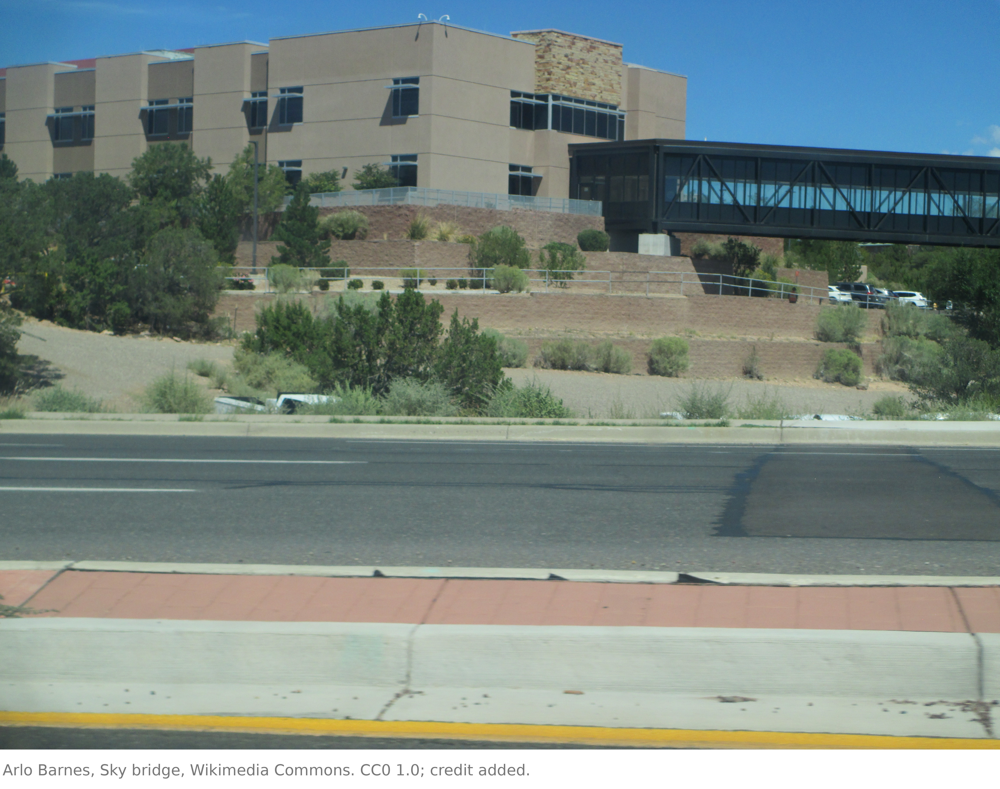

A ground-footprint map may show separate structures even when a bridge connects them.

---

<!-- _footer: "[Geoxy’s Poland project and examples](https://www.geoxy.pl/en.budynki_3d_lod2_city_gml.html) · [3DBAG credit](https://docs.3dbag.nl/en/copyright/)" -->
# A tangent: millions of 3D buildings

While preparing these slides, I found a large collection of 3D building models for Poland.

- Geoxy reports **over 5 million LoD2 buildings** across more than **100,000 km²**.
- The lidar-based models include generalized roof shapes.
- Poland’s geoportal provides LoD2 in selected areas and simpler LoD1 nationwide.

[Explore the Polish data](https://www.geoportal.gov.pl/en/data/other-data/3d-models-of-building/). The illustration is from the Dutch 3DBAG project.

---

<!-- _class: compact -->

# Useful open data sources

- [USDA NAIP imagery](https://naip-usdaonline.hub.arcgis.com/): aerial imagery; check acquisition year and local coverage.
- [USGS 3D Elevation Program](https://www.usgs.gov/3d-elevation-program): elevation and lidar products.
- [OpenStreetMap](https://www.openstreetmap.org/copyright): community-contributed building and road data; completeness varies.
- [Microsoft US Building Footprints](https://github.com/microsoft/USBuildingFootprints): modeled footprints; inspect vintage and limitations.

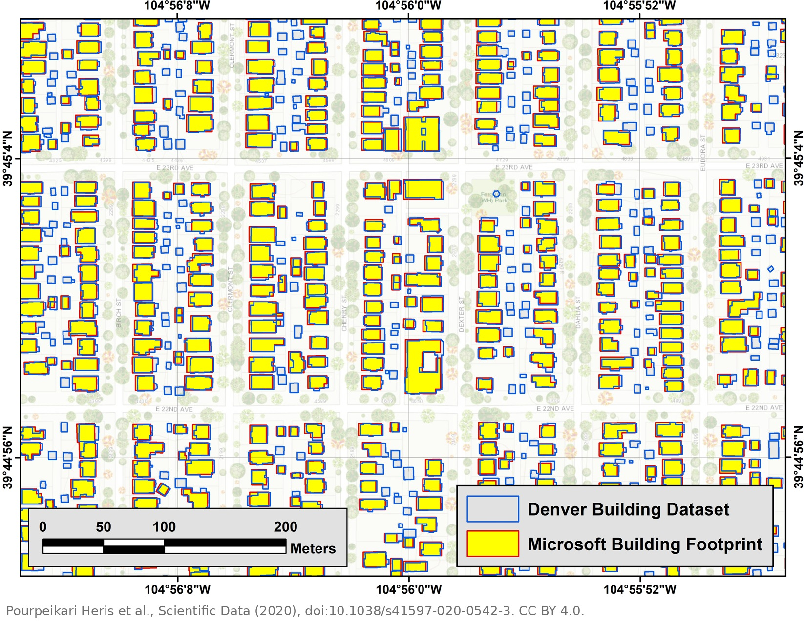

---

<!-- _class: figure -->

# Comparing two footprint sources

Denver reference outlines and Microsoft footprints can disagree, especially for small objects.

---

<!-- _class: divider -->

# 3. From observations to maps

---

<!-- _class: compact -->

# A building-mapping workflow

1. Specify the area, date, minimum building size, and intended use.
2. Inspect imagery and reference labels for alignment and completeness.
3. Build or apply a model; map predicted building regions.
4. Evaluate on independent locations and inspect errors.
5. Summarize exposure only after checking spatial overlays and uncertainty.

---

<!-- _class: figure -->

# Start by inspecting imagery and labels

Tajikistan image and OSM building labels: HOT VHR dataset. See source notes.

---

<!-- _class: compact -->

# Pixel accuracy can be misleading

If 95% of pixels are background, a map that labels every pixel background is 95% accurate.

For the building class, use a confusion matrix and consider:

$$\text{precision}=\frac{TP}{TP+FP},\qquad \text{recall}=\frac{TP}{TP+FN}$$

Precision asks how many predicted building pixels are correct; recall asks how many reference building pixels were found.

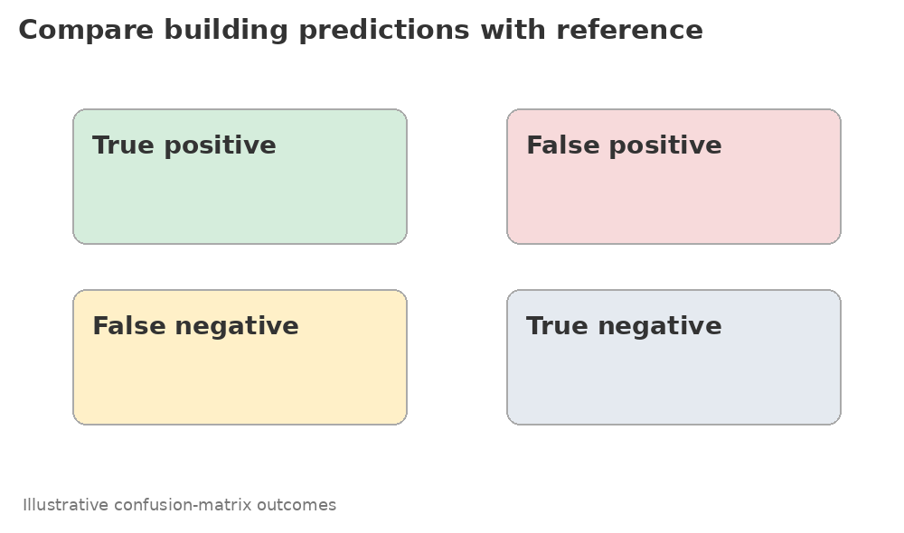

---

<!-- _class: figure -->

# Four possible pixel outcomes

Precision and recall ask different questions about these outcomes.

---

<!-- _class: compact -->

# Measure overlap

For a predicted mask and a reference mask, intersection over union is:

$$\operatorname{IoU}=\frac{|\text{prediction}\cap\text{reference}|}{|\text{prediction}\cup\text{reference}|}$$

IoU is sensitive to missing and extra area. A good pixel score does not necessarily mean that adjacent buildings were separated correctly.

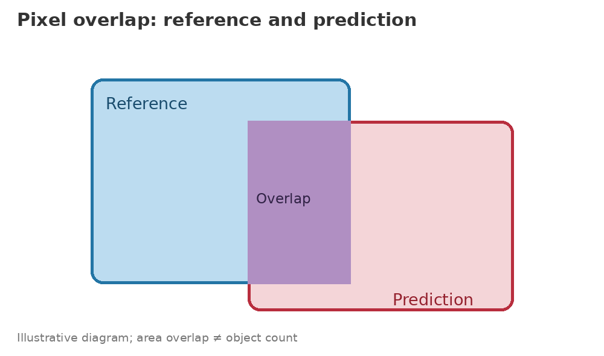

---

<!-- _class: figure -->

# Intersection over union

IoU = intersection area / union area.

---

<!-- _class: compact -->

# Count buildings carefully

- One merged prediction can cover several buildings.
- One fragmented roof can produce several detections.
- Object-level evaluation needs an explicit matching rule, such as an IoU threshold.
- Report missed and extra buildings as well as boundary overlap.

---

<!-- _class: compact -->

# A merge that hides a missing building

Two reference roofs each have 400 pixels. A predicted mask adds four bridge pixels, joining them into one component.

- Pixel IoU = $800/804 \approx 0.995$.
- At object IoU $\geq 0.40$, the merged prediction matches at most one roof.
- Result: one matched building and one missed building.
- Connected components are only a proxy for buildings: touching roofs can merge.

---

# The same masks, visually

The exact and merged predictions have nearly identical pixel overlap, but produce different counts. These masks are synthetic.

---

<!-- _class: compact -->

# Spatial validation matters

- Random neighboring patches often share roofs, lighting, and acquisition artifacts.
- Hold out entire locations or imagery scenes for a more realistic transfer test.
- Representative independent samples are needed for citywide accuracy estimates.
- Do not evaluate against the same modeled footprints used for training.

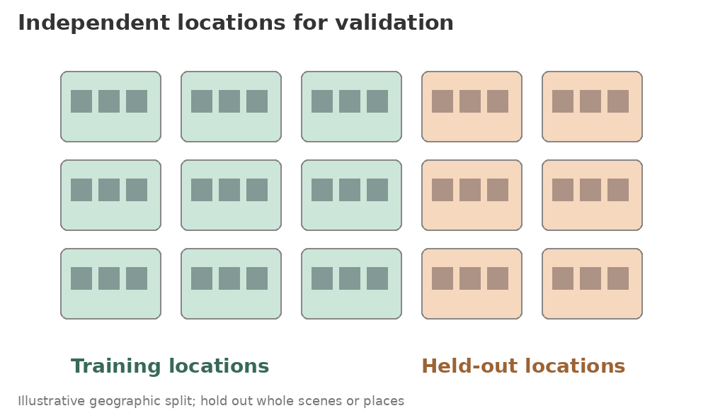

---

# Reference data can be wrong

- A reference map may be incomplete or from a different date.
- Inspect disagreement before calling every prediction an error.
- Independently collected, representative reference data support credible accuracy estimates.

---

# Demonstration: map and measure

[Inspect an aerial image and OSM labels in Colab](https://colab.research.google.com/github/jfemiani/cse620b-public/blob/main/Lessons/12-Urban-Infrastructure/demo-building-imagery.ipynb).

[Compare pixel and object metrics in Colab](https://colab.research.google.com/github/jfemiani/cse620b-public/blob/main/Lessons/12-Urban-Infrastructure/demo-building-metrics.ipynb).

Predict first: what happens when two neighboring buildings merge into one predicted region?

---

<!-- _class: compact -->

# Interpretation exercise

A footprint intersects a mapped flood zone, but the footprint and image dates differ. Define a building as potentially exposed if any of its footprint intersects the zone.

| Building | Total footprint | Area inside flood zone |
|---|---:|---:|
| A | 100 m² | 40 m² |
| B | 60 m² | 60 m² |
| C | 80 m² | 0 m² |

How many buildings are exposed? Compare their total footprint area with their area inside the zone. What positional or temporal errors could change the results?

Mapped intersection is potential exposure, not evidence that a building flooded or was damaged.

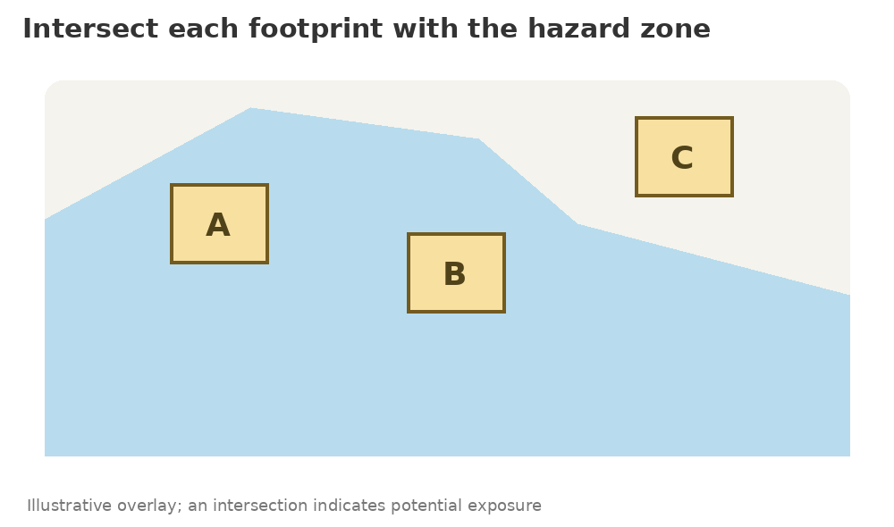

---

<!-- _class: figure -->

# Overlay exercise: visualize exposure

The diagram is illustrative; use the numerical values on the previous slide.

---

<!-- _class: compact -->

# Takeaways

- Define the infrastructure object and decision before choosing a model.
- Match spatial resolution, geometry, and dates to that object.
- Report both pixel overlap and object-level errors when counting buildings.
- Treat derived maps and reference labels as evidence with uncertainty.

---

<!-- _class: compact -->

# Data and reading

- [USDA National Agriculture Imagery Program](https://naip-usdaonline.hub.arcgis.com/)
- [USGS 3D Elevation Program](https://www.usgs.gov/3d-elevation-program)
- [OpenStreetMap attribution and license](https://www.openstreetmap.org/copyright)
- [Microsoft US Building Footprints](https://github.com/microsoft/USBuildingFootprints)

---

<!-- _class: compact -->

# Where is this work published?

- **Remote sensing / photogrammetry:** ISPRS Journal of Photogrammetry and Remote Sensing; IEEE TGRS and JSTARS; Remote Sensing.
- **Computer vision:** CVPR, ICCV, ECCV, and WACV include mapping and 3D reconstruction.
- **Community benchmarks:** SpaceNet and ISPRS datasets link papers, data, code, and evaluation.

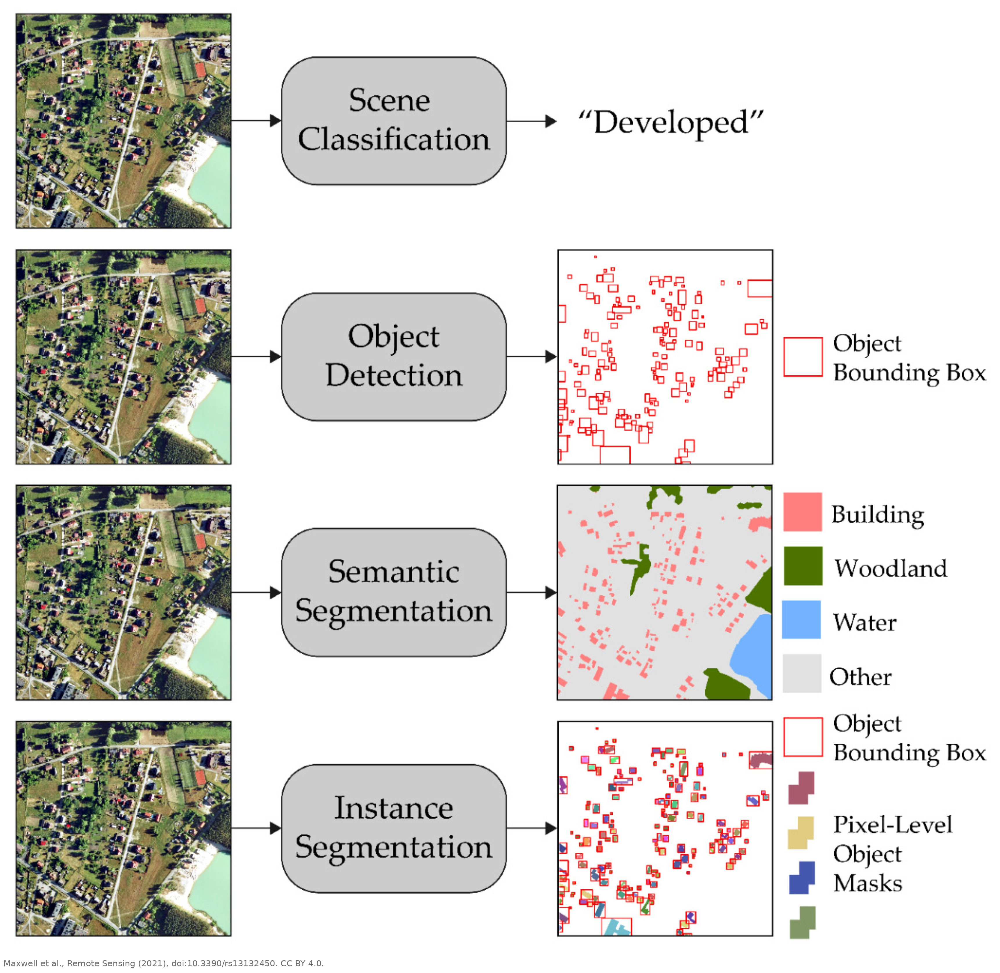

---

<!-- _class: compact -->

# Recent directions and open challenges

- **Polygon prediction:** Pix2Poly (WACV 2025) generates vector building outlines.
- **Off-nadir geometry:** PolyFootNet (TGRS 2025) incorporates roof masks and offsets.
- **Road topology:** graph methods such as RoadTracer, Sat2Graph, and SAM-Road++ target connectivity.
- **Foundation models:** SAM-style adaptation and earth-observation encoders are active research; compare transfer on independent locations.

A 2026 benchmark found strong dataset-dependent tradeoffs among instance models; cross-dataset transfer remains difficult. There is no single best model across sensors, regions, outputs, and metrics.

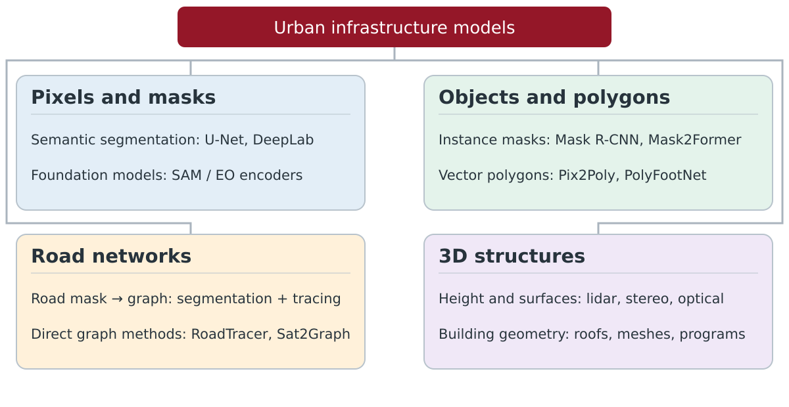

---

<!-- _class: compact -->

# What recent comparisons tell us

- A **2026 building benchmark** compared YOLO segmentation families and Mask R-CNN across accuracy, speed, and transfer.
- Training on WHU and testing on Inria exposed domain shift; performance on one dataset did not guarantee transfer.
- **SAM-Road++ (CVPR 2025)** predicts a road graph and evaluates topology, not just pixel overlap.
- **ArcPro (CVPR 2025)** predicts structured architectural programs from sparse 3D points.

These are examples of active directions, not a universal model ranking.

---

<!-- _class: compact -->

# Further reading and source notes

- [Pix2Poly, WACV 2025](https://openaccess.thecvf.com/content/WACV2025/html/Adimoolam_Pix2Poly_A_Sequence_Prediction_Method_for_End-to-End_Polygonal_Building_Footprint_WACV_2025_paper.html) · [PolyFootNet, IEEE TGRS 2025](https://doi.org/10.1109/TGRS.2025.3590054)
- [RoadTracer](https://mapster.csail.mit.edu/roadtracer.html) · [SAM-Road++, CVPR 2025](https://openaccess.thecvf.com/content/CVPR2025/html/Yin_Towards_Satellite_Image_Road_Graph_Extraction_A_Global-Scale_Dataset_and_CVPR_2025_paper.html) · [SpaceNet](https://spacenet.ai/datasets/)
- [Accuracy assessment recommendations](https://doi.org/10.3390/rs13132591) · [Flood exposure study](https://doi.org/10.5194/nhess-24-699-2024)

A full image and research source list accompanies these slides.

---

<!-- _class: figure -->

# A map of urban infrastructure models

Model families overlap; choose the output and validation for the decision.
