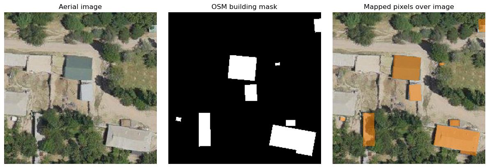
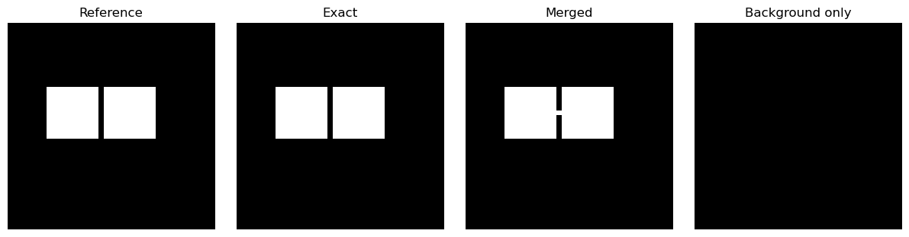

# Remote Sensing of Urban Infrastructure

## From image evidence to building maps

John C. Femiani | CSE 620B

---

# A practical question

A city wants to estimate the number and area of buildings exposed to flooding.

- What can an overhead image actually reveal?
- What spatial resolution is needed to distinguish individual roofs?
- How would we know whether the resulting map is reliable?

---

# What you should be able to do

1. Distinguish land cover, land use, and individual infrastructure objects.
2. Select imagery and reference data for a building-mapping task.
3. Interpret object-level and pixel-level errors.
4. Explain why image predictions need independent validation.

---

<!-- _class: divider -->

# 1. What are we mapping?

---

# Land cover is not land use

- **Land cover:** physical surface, such as roofs, pavement, or trees.
- **Land use:** activity or purpose, such as residential or commercial.
- A bright roof does not by itself reveal a building's use.
- Context, records, and field checks can support an interpretation.

---

# Infrastructure is an object

An individual building has a footprint, shape, location, and relationship to nearby features.

- **Classification:** assign a class to a pixel or region.
- **Detection:** locate candidate objects, often with bounding boxes.
- **Segmentation:** assign an object or class label to pixels.
- A footprint polygon is a geometric representation, not proof of occupancy.

---

# One scene, several tasks

| Question | Output | Unit |
|---|---|---|
| Where are built surfaces? | Land-cover map | Pixel or region |
| Where are buildings? | Footprints or detections | Object |
| Which buildings intersect flood zones? | Exposure inventory | Building |

The right output depends on the decision, not just the available model.

---

<!-- _class: divider -->

# 2. Choose the evidence

---

# Resolution controls the question

- A 10 m pixel represents roughly a 10 m by 10 m ground area.
- A small roof can share that pixel with trees and pavement.
- Finer imagery can resolve individual roofs, but raises data and annotation costs.
- Resolution is not the same thing as positional accuracy.

---

# A roof at two scales

Consider a 20 m by 10 m roof, aligned with the pixel grid:

| Ground sampling | Approximate roof extent | What can we see? |
|---|---|---|
| 10 m per pixel | 2 by 1 pixels | A few mixed or roof-dominated pixels |
| 1 m per pixel | 20 by 10 pixels | Roof shape and separation may be visible |

The outcome also depends on alignment, blur, shadows, and sensor geometry.

---

# Why cities are difficult

- Roofs, roads, and bare soil can have similar colors.
- Shadows and tree canopy can hide parts of a building.
- Tall buildings lean in off-nadir images; roofs and ground footprints may not align.
- Dense blocks make boundaries between adjacent roofs difficult to see.

---

# Look at the image and labels

Tajikistan image and OSM building labels: [HOT VHR dataset](https://huggingface.co/datasets/hotosm/vhr-building-segmentation). Imagery: Open Imagery Network contributors, CC BY 4.0; labels: OpenStreetMap contributors, ODbL 1.0.

---

# Different sensors answer different questions

- **Aerial or high-resolution optical imagery:** visible roof shapes and context.
- **Multispectral satellite imagery:** broad surface composition and repeated coverage.
- **Lidar:** height and 3D structure, subject to point density and coverage.
- **Ancillary data:** footprints, parcels, and flood maps add context but have their own errors.

---

# Roofs are not always footprints

In an oblique image, the roof appears displaced from its ground location.

- Compare acquisition geometry and dates before overlaying a vector map.
- Check alignment on multiple objects across the image.
- Avoid treating a visible roof edge as a surveyed building outline.

---

# Useful open data sources

- [USDA NAIP imagery](https://naip-usdaonline.hub.arcgis.com/): aerial imagery; check acquisition year and local coverage.
- [USGS 3D Elevation Program](https://www.usgs.gov/3d-elevation-program): elevation and lidar products.
- [OpenStreetMap](https://www.openstreetmap.org/copyright): community-contributed building and road data; completeness varies.
- [Microsoft US Building Footprints](https://github.com/microsoft/USBuildingFootprints): modeled footprints; inspect vintage and limitations.

---

<!-- _class: divider -->

# 3. From observations to maps

---

# A building-mapping workflow

1. Specify the area, date, minimum building size, and intended use.
2. Inspect imagery and reference labels for alignment and completeness.
3. Build or apply a model; map predicted building regions.
4. Evaluate on independent locations and inspect errors.
5. Summarize exposure only after checking spatial overlays and uncertainty.

---

# Pixel accuracy can be misleading

If 95% of pixels are background, a map that labels every pixel background is 95% accurate.

For the building class, use a confusion matrix and consider:

$$\text{precision}=\frac{TP}{TP+FP},\qquad \text{recall}=\frac{TP}{TP+FN}$$

Precision asks how many predicted building pixels are correct; recall asks how many reference building pixels were found.

---

# Measure overlap

For a predicted mask and a reference mask, intersection over union is:

$$\operatorname{IoU}=\frac{|\text{prediction}\cap\text{reference}|}{|\text{prediction}\cup\text{reference}|}$$

IoU is sensitive to missing and extra area. A good pixel score does not necessarily mean that adjacent buildings were separated correctly.

---

# Count buildings carefully

- One merged prediction can cover several buildings.
- One fragmented roof can produce several detections.
- Object-level evaluation needs an explicit matching rule, such as an IoU threshold.
- Report missed and extra buildings as well as boundary overlap.

---

# A merge that hides a missing building

Two reference roofs each have 400 pixels. A predicted mask adds four bridge pixels, joining them into one component.

- Pixel IoU = $800/804 \approx 0.995$.
- At object IoU $\geq 0.40$, the merged prediction matches at most one roof.
- Result: one matched building and one missed building.
- Connected components are only a proxy for buildings: touching roofs can merge.

---

# The same masks, visually

The exact and merged predictions have nearly identical pixel overlap, but produce different counts. These masks are synthetic.

---

# Spatial validation matters

- Random neighboring patches often share roofs, lighting, and acquisition artifacts.
- Hold out entire locations or imagery scenes for a more realistic transfer test.
- Representative independent samples are needed for citywide accuracy estimates.
- Do not evaluate against the same modeled footprints used for training.
- A reference map may be incomplete or from a different date.
- Inspect disagreement before calling every prediction an error.

---

# Demonstration: map and measure

[Inspect an aerial image and OSM labels in Colab](https://colab.research.google.com/github/jfemiani/cse620b-public/blob/main/Lessons/12-Urban-Infrastructure/demo-building-imagery.ipynb).

[Compare pixel and object metrics in Colab](https://colab.research.google.com/github/jfemiani/cse620b-public/blob/main/Lessons/12-Urban-Infrastructure/demo-building-metrics.ipynb).

Predict first: what happens when two neighboring buildings merge into one predicted region?

---

# Interpretation exercise

A footprint intersects a mapped flood zone, but the footprint and image dates differ. Define a building as potentially exposed if any of its footprint intersects the zone.

| Building | Total footprint | Area inside flood zone |
|---|---:|---:|
| A | 100 m² | 40 m² |
| B | 60 m² | 60 m² |
| C | 80 m² | 0 m² |

How many buildings are exposed? Compare their total footprint area with their area inside the zone. What positional or temporal errors could change the results?

Mapped intersection is potential exposure, not evidence that a building flooded or was damaged.

---

# Takeaways

- Define the infrastructure object and decision before choosing a model.
- Match spatial resolution, geometry, and dates to that object.
- Report both pixel overlap and object-level errors when counting buildings.
- Treat derived maps and reference labels as evidence with uncertainty.

---

# Data and reading

- [USDA National Agriculture Imagery Program](https://naip-usdaonline.hub.arcgis.com/)
- [USGS 3D Elevation Program](https://www.usgs.gov/3d-elevation-program)
- [OpenStreetMap attribution and license](https://www.openstreetmap.org/copyright)
- [Microsoft US Building Footprints](https://github.com/microsoft/USBuildingFootprints)